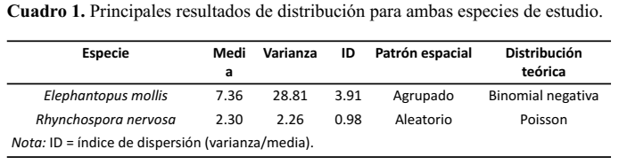
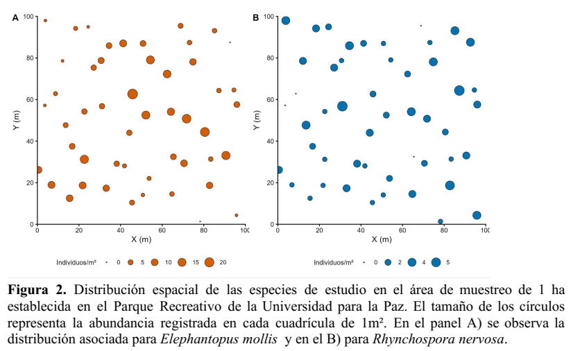

## Summary

The spatial distribution of plant populations provides insight into their organization and the associated ecological processes. The objective of this study was to evaluate and compare the distribution patterns of Elephantopus mollis and Rhynchospora nervosa using grid sampling. An aggregated distribution was predicted for the former species and a random distribution for the latter. The study was conducted in the protected area of El Rodeo, located in Mora, San José, Costa Rica. This site is characterized by the presence of mature trees and marked heterogeneity in vegetation cover and soil conditions. Fifty 1 × 1 m quadrats were randomly established within a one-hectare area. Subsequently, individuals of both species present in each quadrat were manually counted. Data analysis was performed using RStudio and tools from the tidyverse package. The dispersion index (DI) was calculated, and Chi-square and goodness-of-fit tests were applied to evaluate the spatial distribution patterns of both species. The results suggest that Elephantopus mollis exhibits an aggregated distribution pattern fitting a negative binomial distribution (X2=191.8, P\<0.001), whereas Rhynchospora nervosa shows a random distribution pattern fitting a Poisson model (X2=48.0, P=0.512). These findings confirm contrasting spatial structures between both species.
\

## Introduction

In population ecology, the study of spatial distribution is important because it helps explain how individuals are arranged within a given area (Borregaard et al., 2008) and is essential for drawing inferences about the processes that shape population dynamics and structure (Hernández-Cruz et al., 2025). In plants in particular, studying spatial distribution has helped identify how some species disperse, their environmental requirements, and even their interactions with other species (Ben-Said, 2021). Based on how individuals are arranged in space, three spatial patterns are recognized: random, uniform, and clumped (Rockwood, 2006). A clumped distribution is characterized by groups of individuals and is usually associated with shared preferences for certain environmental conditions and food resources (Borregaard et al., 2008).

A uniform distribution, on the other hand, is associated with species whose individuals are evenly spaced because of competition for resources, territoriality, or density-dependent mortality related to neighboring individuals (Stoll & Bergius, 2005). Less commonly, species are distributed randomly (Fangliang et al., 1997), a pattern that tends to occur when resources are distributed homogeneously (De Freitas Alves & De Santana, 2022). However, the interpretation of distribution patterns depends on the scale of the study (Levin, 1992).

Ecological processes may shape observed distribution patterns. These include interactions among individuals and dispersal (Vinatier et al., 2011). In practice, quadrat sampling makes it possible to count the individuals within a defined area and estimate their density. Abundance is then compared among sampling units, and statistical measures such as the mean and variance are used to determine the spatial distribution pattern (De Freitas Alves & De Santana, 2022).

This study determined the spatial distribution of *Elephantopus mollis* (Kunth) and *Rhynchospora nervosa* (Vahl) Boeckeler. *E. mollis* (Figure 1A) is a perennial species in the family Asteraceae, with a broad distribution throughout the subtropics and tropics (Royal Botanic Gardens, Kew, n.d.). It is a strong competitor: it forms dense rosettes that commonly prevent other plant species from growing through competitive exclusion. It also has a germination rate of 80% across a broad temperature range, from 21 to 34°C (Guerra et al., 2026). *R. nervosa* (Figure 1B), in contrast, is a perennial species in the family Cyperaceae that grows preferentially in seasonally dry climates (Royal Botanic Gardens, Kew, n.d.). It has a rhizomatous growth form, producing clusters of stems from an underground structure (Gómez-Laurito, 2009). An allelopathic effect on other plants has been documented for this species, as it inhibited the germination and early growth of *Vigna unguiculata* seedlings (Bezerra et al., 2026).

## Objetive

The objectives of this study were to evaluate and compare the spatial distribution patterns of these two plant species using abundance data obtained from quadrats. The null hypothesis was that, for each species, abundance among sampling units would be consistent with a random spatial distribution. The alternative hypothesis was that abundance would not be consistent with a random distribution. Based on preliminary observations, our first prediction was that *Elephantopus mollis* would show a clumped distribution, whereas our second prediction was that *Rhynchospora nervosa* would show a pattern consistent with a random distribution.\

## Metodology

### Study area

Sampling took place in an area of herbaceous vegetation and scattered trees within the Recreational Park of the University for Peace, located in the protected area of El Rodeo, Mora, San José, Costa Rica (9° 55′ 9.09″ N, 84° 16′ 21.29″ W), at an elevation of 784 m above sea level. Sampling was conducted on October 6, from 10 a.m. to 2 p.m. The site has rolling topography, scattered mature trees, and visible variation in vegetation cover and soil conditions.

### Study species

We studied two herbaceous species with different growth forms. The first, *Elephantopus mollis*, is an erect herb 0.3–1.5 m tall, with generally hairy stems and alternate, obovate to elliptic leaves with a broadened base and toothed margins (Tropicos.org, 2026; Figure 1A). Plants that could be recognized as independent individuals were counted. The second, *Rhynchospora nervosa*, is a perennial herb 10–70 cm tall. It grows in clumps or from rhizomes and has narrow leaves (Tropicos.org, 2026; Figure 1B). Each independent clump, or one clearly separated from other clumps, was considered an individual. Individual stems were not counted separately.

### Sampling design

A 100 × 100 m study area (1 ha) was delineated and divided into 50 sectors measuring 10 × 20 m. One 1 × 1 m quadrat was randomly established within each sector, for a total of 50 quadrats. A reference point (0,0) was established for the study area to determine the spatial coordinates (X and Y, in meters) of each quadrat within its sector. The sampling units were divided between two groups of four people, and the two data sets were later combined into a single database. For each quadrat, the number of *E. mollis* and *R. nervosa* individuals was recorded. Environmental variables were not considered in the sampling and therefore were not included as evidence of the processes responsible for the observed patterns.

### Data analysis

Data processing and analysis were conducted in R version 4.6.1 (R Core Team, 2026) using RStudio (Posit team, 2026) and functions from the “Tidyverse” package, version 2.0.0 (Wickham et al., 2019). The dispersion index (DI), defined as the ratio of the sample variance to the sample mean, was calculated to characterize the spatial pattern. DI values below 1 indicate a uniform distribution; values close to 1 suggest a random distribution; and values greater than 1 indicate a clumped distribution.

A chi-square (χ²) test was used to assess whether the observed distribution differed from randomness. Based on the significance level and the distribution indicated by the data, the fit of theoretical probability models was assessed: a binomial distribution for *E. mollis* and a Poisson distribution for *R. nervosa*, using functions from the “MASS” package, version 7.3-66 (Venables et al., 2002). The goodness of fit of the data to each distribution was evaluated with a chi-square goodness-of-fit test. The significance level for statistical decisions was set at 5%.

The main results were organized in a table using the “gt” package, version 1.3.0 (Iannone et al., 2020). Point plots were produced to visualize the spatial distribution within the study area, and bar charts and trend lines were used to visualize how well the data fit the distributions, using “ggplot2” (Wickham, 2016). The figures were finalized and assembled with the “cowplot” package, version 1.2.0 (Wilke, 2025).

## Results

The dispersion index for *Elephantopus mollis* was greater than 1 (χ² = 191.8, df = 49, P \< 0.001), indicating a clumped distribution that differed from randomness, with variance considerably greater than the mean (Table 1; Figure 2). This behavior is characteristic of counts with high spatial aggregation. The chi-square goodness-of-fit test found no statistically significant difference between the observed data and the expected negative binomial distribution, indicating that the *E. mollis* counts fit this probability model well (χ² = 0.3, df = 2, P = 0.871; Figure 3A). This result agrees with the clumped spatial pattern identified earlier and with the observed overdispersion.

For *Rhynchospora nervosa*, there was no evidence that the observed abundance differed from a random spatial pattern (χ² = 48.0, df = 49, P = 0.512; Figure 1B). This agrees with the calculated DI, which was close to 1 and indicates random dispersion in the study area. The goodness-of-fit test also showed an adequate fit to the Poisson distribution (χ² = 2.8, df = 2, P = 0.249; Figure 3B), consistent with the random distribution of this species.

## Interpretations

The results showed that *Elephantopus mollis* had a more clumped distribution because individuals were more concentrated in some quadrats than in others. This agrees with the overdispersion indicated by the DI, which was greater than 1, while the chi-square test showed a statistically significant departure from randomness. The counts also tended to fit a negative binomial distribution, indicating high variation among the study quadrats. The accumulation of individuals and possible preference for certain sites could contribute to this clumping, considering that the species can germinate under a wide range of environmental conditions that may influence this pattern (Guerra et al., 2026).

Regarding *R. nervosa*, Mora-Fernández and Peñuela-Recio (2013) note that this species has a broad distribution and can adapt to infertile sites such as savannas and pastures. It is also found in dry, humid, rain, and cloud forests. This suggests that its adaptive plasticity allows it to occur in many types of sites without depending on a clumped distribution around a particular resource. The dispersion index obtained (0.98) indicates random dispersion across the quadrats. This is also consistent with an untested hypothesis that homogeneous site conditions may allow a distribution not constrained by specific resources. The mean abundance was 2.30 individuals per quadrat, and the variance was 2.26.

Consistent with these results, the chi-square test supports the decision not to reject the null hypothesis, indicating that the data are close to a random distribution model. The goodness-of-fit test values show an adequate fit to the Poisson distribution, which is compatible with a random spatial pattern.

Spatial distribution alone does not allow us to infer the ecological processes underlying it. However, it is very useful when combined with more focused ecological studies. Other studies identify members of the Cyperaceae family, including the genus *Rhynchospora*, as pioneer and generalist species with high colonization capacity (Valois-Cuesta & Martínez-Ruiz, 2017). Thus, combining ecological studies with spatial distribution studies can contribute to our understanding of the processes that shape species distributions.

Finally, differences in the spatial distributions of the two species may be related to their traits, such as the rosette growth form of *E. mollis* and the rhizomatous growth form of *R. nervosa*. Since both species were found at a site with herbaceous vegetation, scattered trees, rolling terrain, and variation in vegetation cover, their growth forms could be observed under the same general site conditions. *E. mollis* was found in clusters averaging more than seven individuals, consistent with reports that this species can form dense rosettes that spread and displace other species through competitive exclusion (Guerra et al., 2026). *R. nervosa*, by contrast, showed a different distribution. Its rhizomatous growth allows it to explore the surrounding area more extensively and spread laterally, which may favor the colonization of available patches (Herben & Klimešová, 2020).

## Conclusions

Among the practical limitations of this study, it is important to consider how the scale of observation may have influenced the observed distribution patterns, as well as the composition and structure of the study area. Replicating the study in contrasting ecosystems is therefore recommended to better understand spatial distribution patterns. It is also important to assess the influence of environmental variables such as vegetation cover, temperature, and soil acidity. Finally, the methodology should be standardized through periodic repeated sampling over time to observe how the species behave as part of the natural assemblage within the landscape.

## Bibliography
