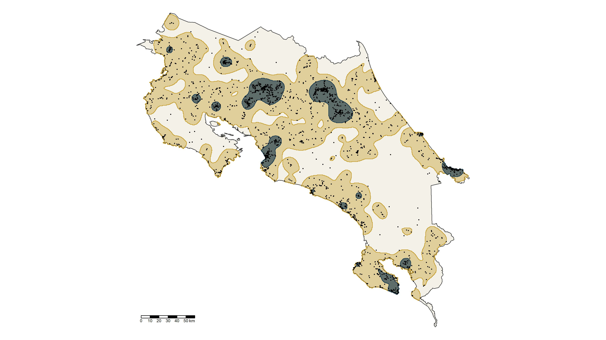
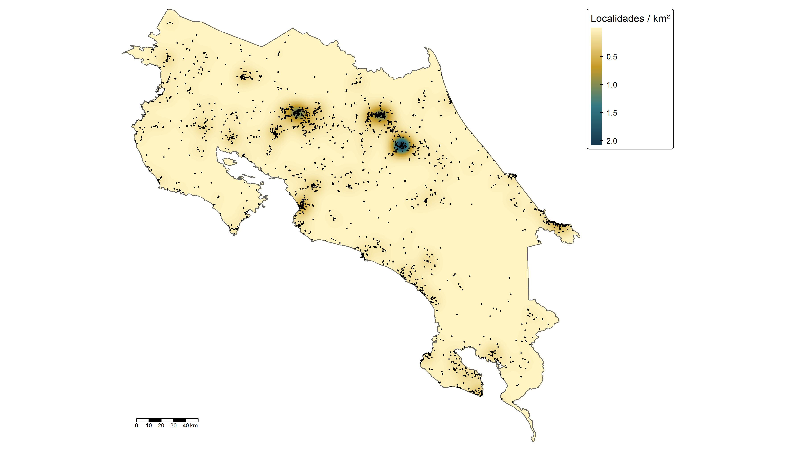

## Introduction

Kernel Density Estimation (KDE) is a spatial method that smooths point locations to show where records are concentrated. Applied to the spectacled owl (*Pulsatrix perspicillata*), it helps visualize clusters of reported localities across Costa Rica. The species is associated with a range of tropical habitats, including forests, savannas, and wetlands. [IUCN Red List](https://doi.org/10.2305/IUCN.UK.2018-2.RLTS.T22689180A130161018.en)

## Objective

To describe the spatial concentration of *Pulsatrix perspicillata* records in Costa Rica using KDE maps and identify areas with higher and lower record density.

## Metodology

Records of *Pulsatrix perspicillata* were cleaned by converting coordinates to numeric format, removing duplicate localities, and retaining those that intersect Costa Rica. The points were then projected to CRTM05 so distances could be calculated in meters.

A Gaussian kernel density surface was estimated using a 5,000 m bandwidth and 500 m cells. The surface was cropped and masked to Costa Rica, and values were expressed as recorded localities per km².

Polygons representing 50% and 95% of the cumulative density were delineated: the 50% polygon shows areas with the highest concentration of records, while the 95% polygon covers a broader region. These results describe the concentration of recorded localities; they do not represent individual abundance or confirmed distribution boundaries.

## Results

{fig-align="center"}

{fig-align="center"}

## Interpretations

**Figure 1. KDE contours and locality records.** The map appears to overlay occurrence points with shaded or outlined density areas. The most concentrated patches are visible in the north-central and central parts of the country, with smaller clusters elsewhere. Because the figure has no visible legend, the density values and color categories cannot be specified.

**Figure 2. KDE density surface.** The pale-yellow areas represent lower record density, while green, teal, and dark-blue areas represent progressively higher density. The strongest clusters appear in the central and north-central interior; most other areas show lower density, with records dispersed across the country. The legend reports density in localities per square kilometer, reaching approximately 2 localities/km² at the upper end shown.

## Conclusions

- Both figures show that records are spatially clustered rather than evenly distributed across Costa Rica.

- The highest KDE values occur in localized areas, especially in the central and north-central parts of the country.

- These maps show the density of records, not owl abundance or habitat suitability; record density may also reflect where observations were collected.

## Bibliography
