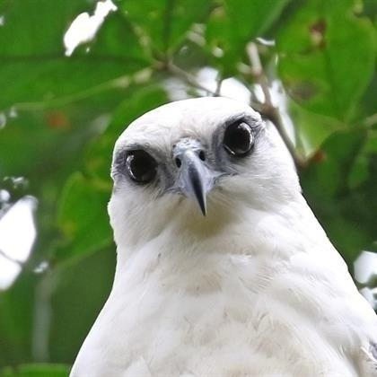

::: {.perfil-superior}

::: {.perfil-foto}

{fig-alt="Fotografía de perfil"}

:::

::: {.perfil-info}

# Daniela Blanco

## Bachelor’s Student in Tropical Biology

School of Biological Sciences /
National University of Costa Rica

::: {.enlaces-perfil}

[<i class="bi bi-envelope-fill"></i> Correo](mailto:daniela.blanco.espinoza@est.una.ac.cr)

[<i class="bi bi-github"></i> GitHub](Linkedin: https://www.linkedin.com/in/daniela-blanco-78431b273)

[<i class="bi bi-person-badge-fill"></i> ORCID](https://orcid.org/0000-0003-2692-2022)

[<i class="bi bi-linkedin"></i> LinkedIn](Linkedin: https://www.linkedin.com/in/daniela-blanco-78431b273)

:::

:::

:::

---

## Biography

I am a Tropical Biology undergraduate student with a strong interest in tropical ecology and biodiversity conservation, particularly the study of wild plants and animals. My interests include ornithology, especially birds of prey; mammalogy, particularly felids; entomology, with a focus on beetles; and botany, especially the Araceae family.

I am also interested in applying geographic information systems (GIS), spatial analysis, and species distribution modeling to understand ecological patterns and support wildlife conservation efforts.
My professional goal is to contribute to scientific research and develop solutions that promote the protection and sustainable management of tropical ecosystems. 

---

## Areas of Interest

- Ecología
- Conservación
- Biodiversidad
- Biogeografía
- Manejo de Vida Silvestre 
- Ciencia de datos
- Restauración Ecológica
- Monitoreo de Biodiversidad 
- Botánica

---

## Skills

- R
- Quarto (currently learning)
- Git and GitHub
- Geographic Information Systems (GIS)
- Microsoft Office
- Scientific research
- Fieldwork
- Ecological sampling
- Tropical wildlife identification
- Data visualization
- Species distribution modeling

---

## Education

**National University of Costa Rica (UNA)**

Bachelor’s Student in Tropical Biology

*2021 – Presente*
