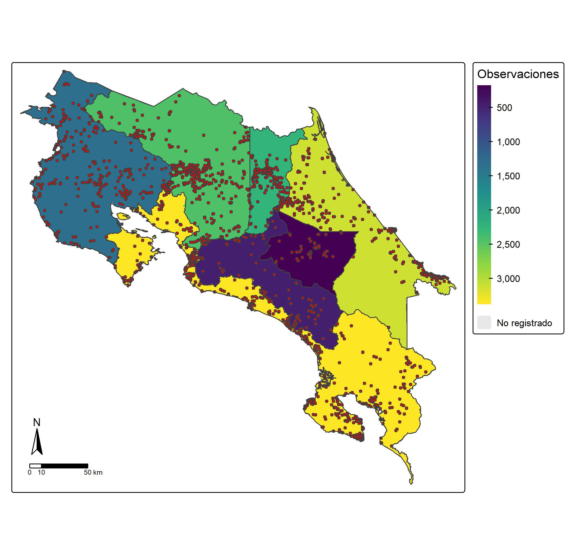
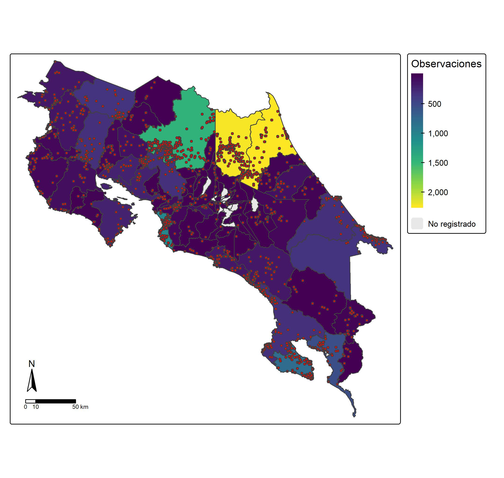

## Introduction

The occurrence records in this section show where and when *Pulsatrix perspicillata* has been observed. Records were reviewed for verification and accuracy; those with missing or unreliable information were removed. This produced a more reliable dataset for analyzing the species’ distribution in Costa Rica.

## Objetive

To analyze the geographic and temporal distribution of *P. perspicillata* observations in Costa Rica using cleaned records from GBIF and iNaturalist, examining the number of records by canton and province and how record counts have changed over time.

## Metodology

Occurrence records were downloaded directly from GBIF and iNaturalist using R. The data were then cleaned to create a more reliable dataset and converted into spatial data using WGS 84 coordinates. Geographic boundary layers for Costa Rica, its provinces, and its cantons were added to assign administrative information to each observation. Finally, records were counted by area and year, and maps and charts were created to visualize the data and support the analysis of the species’ distribution.

## Results

The maps show a broad and clear distribution of *P. perspicillata* based on the cleaned records. Records are present in different regions of Costa Rica. The number of records varies by area, whether by canton or province. Some areas stand out for having more observations, such as Pococí and Sarapiquí, which have more records than other cantons, particularly from 2000 onward.

{fig-align="center"}

{fig-align="center"}

{fig-align="center"}

## Interpretations

The map shows that the number of observations varies by province, with Limón and Puntarenas having the highest numbers. At the canton level, Pococí and Sarapiquí each have more than 1,500 observations, followed by San Carlos with slightly more than 1,000 observations. These numbers represent sighting reports, not the abundance of *P. perspicillata*.

## Conclusions

This analysis describes the geographic distribution of the species and the timing of observations in Costa Rica. However, these observations do not represent actual abundance, as the records are influenced by search effort.

## Bibliography
