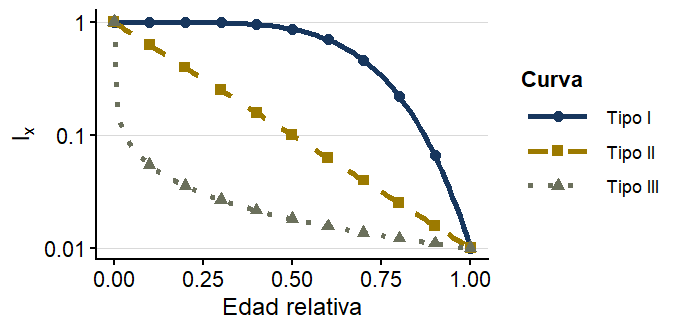

## Introduction

Life tables are valuable tools in population ecology for organizing and analyzing demographic data throughout individuals’ lifespans. They can record variables such as the number of individuals surviving at different ages or life stages, as well as patterns of mortality and survival. This information can be used to assess how the probability of survival changes as individuals age and to represent these patterns with survival curves.

## Objetive

The objective of this exercise was to construct and analyze life tables using human mortality records from cemeteries in Heredia and San José. We aimed to characterize survival patterns, assess how well they correspond to the theoretical Type I, Type II, and Type III survivorship models, and determine whether the distribution of ages at death differs between the two locations. The study addressed the following questions: What survival pattern is shown by the mortality records from the populations studied? Does the distribution of ages at death differ between Heredia and San José?

## Metodology

The fieldwork was conducted at the General Cemetery in San José, Costa Rica, in August 2026. Students systematically sampled graves and recorded each person’s sex, birth year, and death year from the headstones. Only records with all three variables were included, and each person was treated as a separate record, even when multiple people were listed on the same grave.

Data collected by the groups were combined into a class dataset of approximately 1,500–2,000 records using Epicollect5. The Heredia dataset was provided by the instructor and had been collected using a similar method in 2025.

## Results

{fig-align="center"}

| Sex    | n    | median | q1  | q3  |
|--------|------|--------|-----|-----|
| Female | 1311 | 77     | 61  | 86  |
| Male   | 1452 | 68     | 48  | 80  |

: Table 1. Representation of quartiles, the median and the number of individuals by study sex.

| Site     | n    | mediab | q1  | q3  |
|----------|------|--------|-----|-----|
| Heredia  | 1403 | 72     | 54  | 84  |
| San José | 1360 | 72     | 54  | 84  |

: Table 2. . Representation of quartiles, the medianm and the number of individuals by site

## Interpretations

Analysis of the systematic sampling data supported Hypothesis 1: both populations showed a pronounced Type I survivorship curve (\\(l_x\\)), characterized by high survival during early and middle life and a sharp decline after age 50 [@arribalzaga2007]. Regarding the main research question and Hypothesis 2, the null hypothesis (\\(H_0\\)) was accepted because no clear differences were found in the distribution of ages at death between the two provinces. Both provinces also had a median age at death of 72 years and the same interquartile range. When the data were analyzed by sex, women showed greater longevity than men. This difference is consistent with biological and behavioral factors that may make men more likely to die at various younger ages (Garduño Andrade, 2025).

Figure 3 compares the age and sex structure of mortality in the two study populations. In both Heredia and San José, the age pyramids show a concentration of deaths among people over 70, visually illustrating the Type I survivorship pattern (Rosero Bixby Luis, 2008). The two sites show no clear differences in the overall shape of the pyramids, suggesting similar demographic patterns. In addition, Figure 3B shows greater female survival at older ages, supporting the finding of sex differences in longevity and a higher life expectancy for women at the study sites.

## Conclusions

In conclusion, the data analyzed revealed no significant differences in mortality between the two provinces, and their demographic parameters were broadly similar. However, the provinces’ proximity and several limitations of using cemetery records should be considered when interpreting this similarity. These include migration between the provinces, burials not recorded in official records, missing information on headstones, and incomplete access to each cemetery’s records. Despite these limitations, the results are consistent with expectations.

## Bibliography
