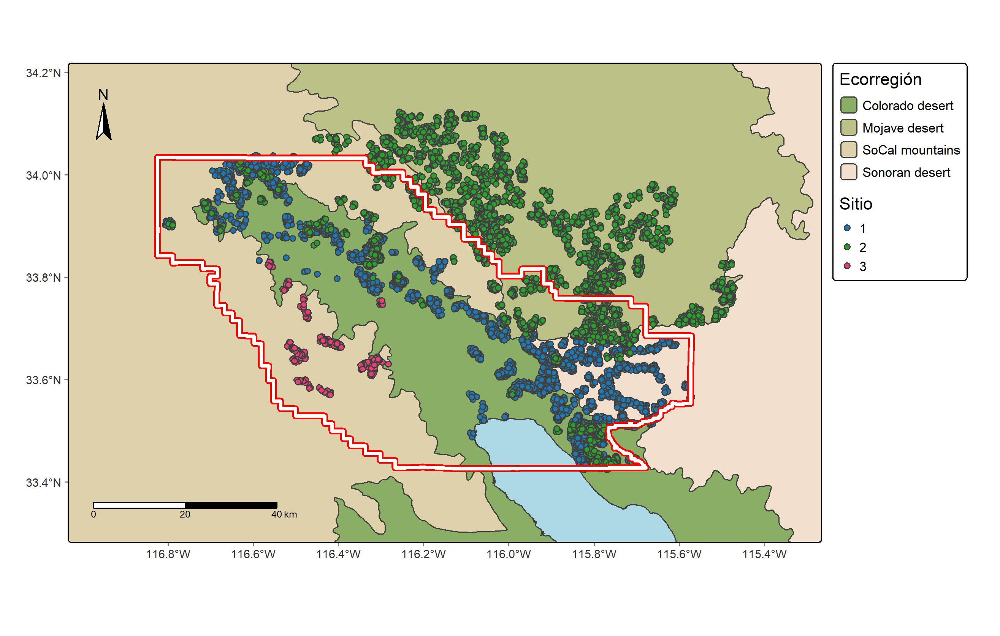
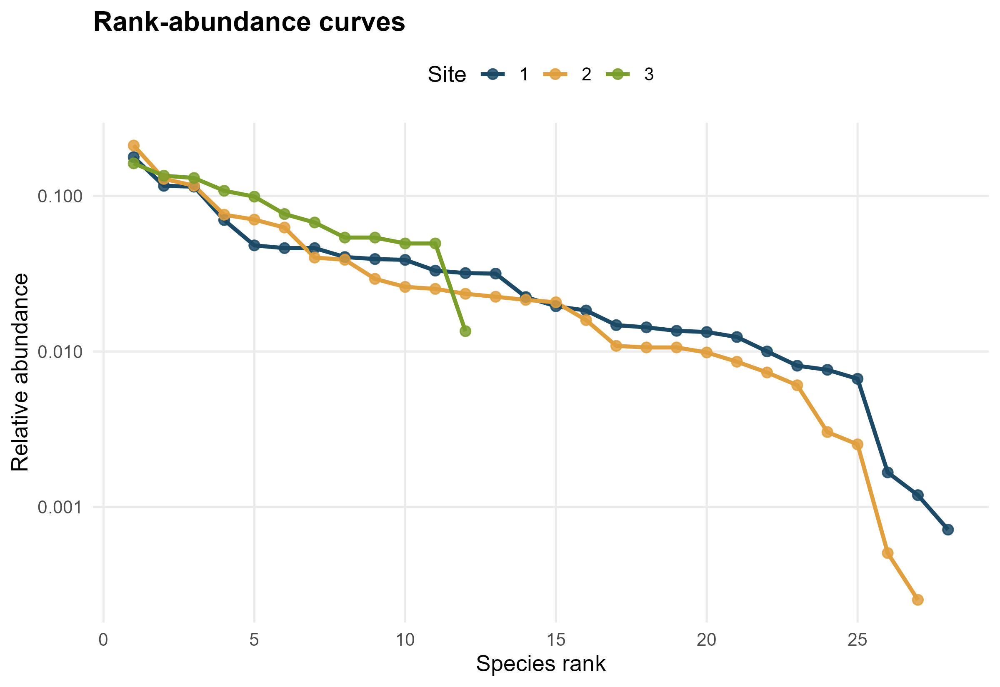

## Introduction

Biological diversity can be described in terms of species richness and the distribution of species abundances. Rank-abundance curves allow these features to be compared across sites: a longer curve represents greater richness, while its slope provides a visual indication of evenness and the dominance of the most common species. Mapping localities by ecoregion also helps show how records are distributed across different environments. These figures allow comparisons among three sites, although they do not, on their own, explain the causes of the observed patterns.

## Objetive

To compare the spatial distribution of records across ecoregions and describe differences in species richness, dominance, and evenness among Sites 1, 2, and 3 using the rank-abundance curve.

## Metodology

Records from the *ccb_dataset* were grouped by site and species. Sampling locations were mapped in WGS84 alongside the Coachella Valley boundary, surrounding ecoregion, and Salton Sea.

Species record counts were summarized for each site and sampling plot, and community matrices were created. Alpha diversity was calculated by site and plot using total records (N), species richness (S), Shannon diversity, Simpson diversity, dominance, and Pielou’s evenness. Gamma diversity was calculated for the pooled dataset.

Between-site beta similarity was assessed from presence–absence data using Jaccard and Sørensen indices. Results were visualized with rank-abundance curves, plot-level alpha diversity comparisons, relative abundance of the 15 most frequently recorded species, and a Jaccard similarity heatmap. Figures were exported as JPG files at 300 dpi.

## Results

## Interpretations

**Figure 1. Records by site and ecoregion.** Records from the three sites are distributed unevenly among the ecoregions shown. Site 2 (green) appears widely across the northern and eastern parts of the map, mainly in areas of the Mojave Desert ecoregion. Site 1 (blue) is more concentrated in central and southern areas, while records from Site 3 (pink) are fewer and occur in localized clusters. Records from different sites occur close together in some areas, suggesting some spatial overlap. The red outline marks an area, but the figure does not include a legend explaining what it represents.

**Figure 2. Rank-abundance curves.** Sites 1 and 2 have longer curves, with approximately 28 and 27 species, respectively, while Site 3 has about 12. Thus, Site 1 has the greatest observed species richness and Site 3 the lowest. Site 2 begins with a higher relative abundance for the top-ranked species, suggesting greater dominance by that species. The curve for Site 1 extends slightly farther into the less abundant species. At Site 3, abundance declines gradually through much of the curve, although there is a marked drop in the final ranks. These differences are descriptive; a formal comparison of evenness or diversity would require abundance data and the corresponding indices.

## Conclusions

- Records from the three sites are not distributed evenly across the ecoregions; the map shows clusters and some spatial overlap.

- Based on curve length, Sites 1 and 2 have greater observed species richness than Site 3.

- Site 2 appears to have greater dominance by its most abundant species, while differences in evenness among sites require quantitative analysis.

## Bibliography
