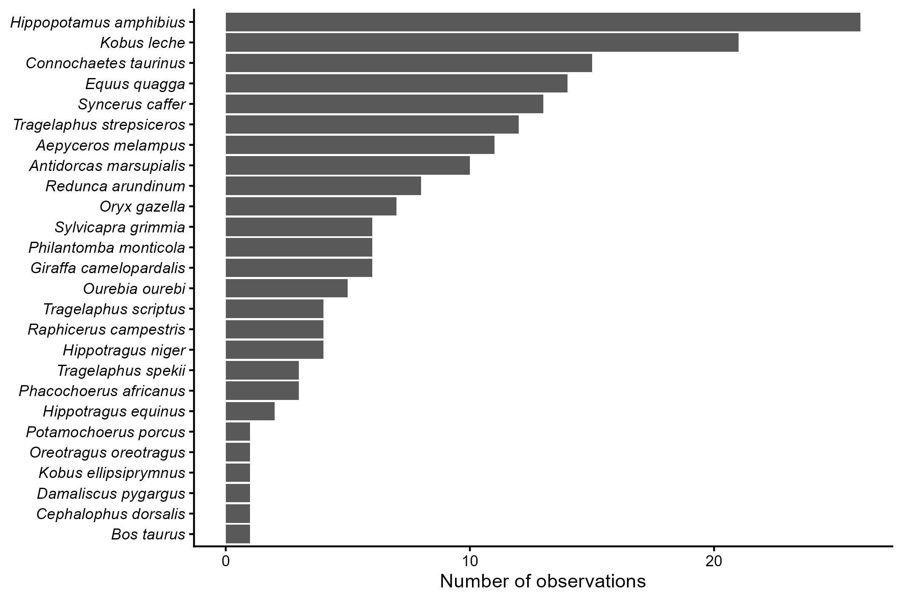

## Introduction

La organización y depuración de datos son pasos muy importantes para obtener resultados confiables y puntuales en un análisis estadístico. Para esta se trabajó con dos set de datos, uno uno de registros metereológicos de cinco estaciones y otro de observaciones de ungulados en Angola. Para poder análizar estos datos se utilizó RStudio y también se requirió funciones del paquete tidyverse puesto que requería de algunas correcciones como ordenar variables, corregir su estructura para facilitar su interpretación.

Para el set de datos meteorológico, los días de marzo estaban distribuidos en varias columnas por lo tanto, los datos fueron reorganizados para obtener una fila por observación diaria; luego se combinaron el año y el día para crear una fecha, se separaron temperatura máxima de temperaura mínima y se transformaron algunas variables numéricas. Posteriormente, con los datos depurados y transformados, se calcularon promedios de temperatura, precipitación y nieve según estación.

En el set de datos de ungulados, se creó una fecha desde las columnas de año, mes y día; también se tomaron las columnas de género y especie para combinarlas y así crear una sola columna de nombre científico y se separó la información taxonómica en clase, orden y familia . Finalmente, se contó el número de observaciones por especie se realizó una tabla taxonómica y un gráfico de observaciones por especie.

## Objetive

El objetivo de esta práctica fue aplicar transformaciones, separación, combinación, selección y agrupación para organizar de mejor manera conjuntos de datos para su posterior análisis mediante tablas y gráficos para facilitar su comprensión.

## Metodology

## Results

La siguiente figura muestra numero de observaciones por especie

## Interpretations

## Conclusions

## Bibliography
