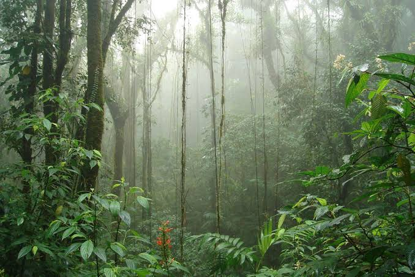
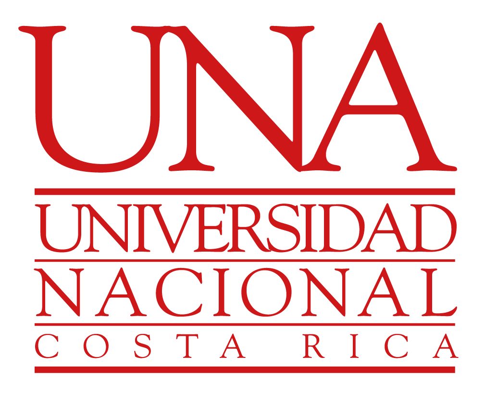

::::: hero-portada
::: hero-texto
# Daniela Blanco

## Bachelor’s Degree Student in Tropical Biology

School of Biological Sciences\
National University of Costa Rica

[View my profile](about.qmd){.btn-portada}\
[Explore my portfolio](portfolio.qmd){.btn-portada .btn-secundario}
:::

::: hero-imagen
{fig-alt="Imagen representativa de biodiversidad y trabajo científico"}
:::
:::::

::: bloque-bienvenida
## Welcome

This website is my **academic digital portfolio**, where I will document the laboratory exercises, projects, analyses, and other work completed during the **Population and Community Ecology** course.

The portfolio uses reproducible science tools such as **R**, **Quarto**, **Git**, and **GitHub** to organize and share my work professionally.
:::

## Site Contents

::::: tarjetas-inicio
::: tarjeta-inicio
### Profile

Personal information, academic interests, and experience.

[Go to Profile →](about.qmd)
:::

::: tarjeta-inicio
### Portfolio

A record of the exercises, projects, and work completed during the course.

[View porfolio →](portfolio.qmd)
:::
:::::

::: mensaje-final
> *Science only has value when it can be communicated and reproduced.*
:::

------------------------------------------------------------------------

## Tools and Affiliation

This portfolio was created using reproducible science tools.

::: {.logos-portada}

{width=150}

{width=70}

{width=70}

:::

**Última actualización:** 4 de Agosto 2026
