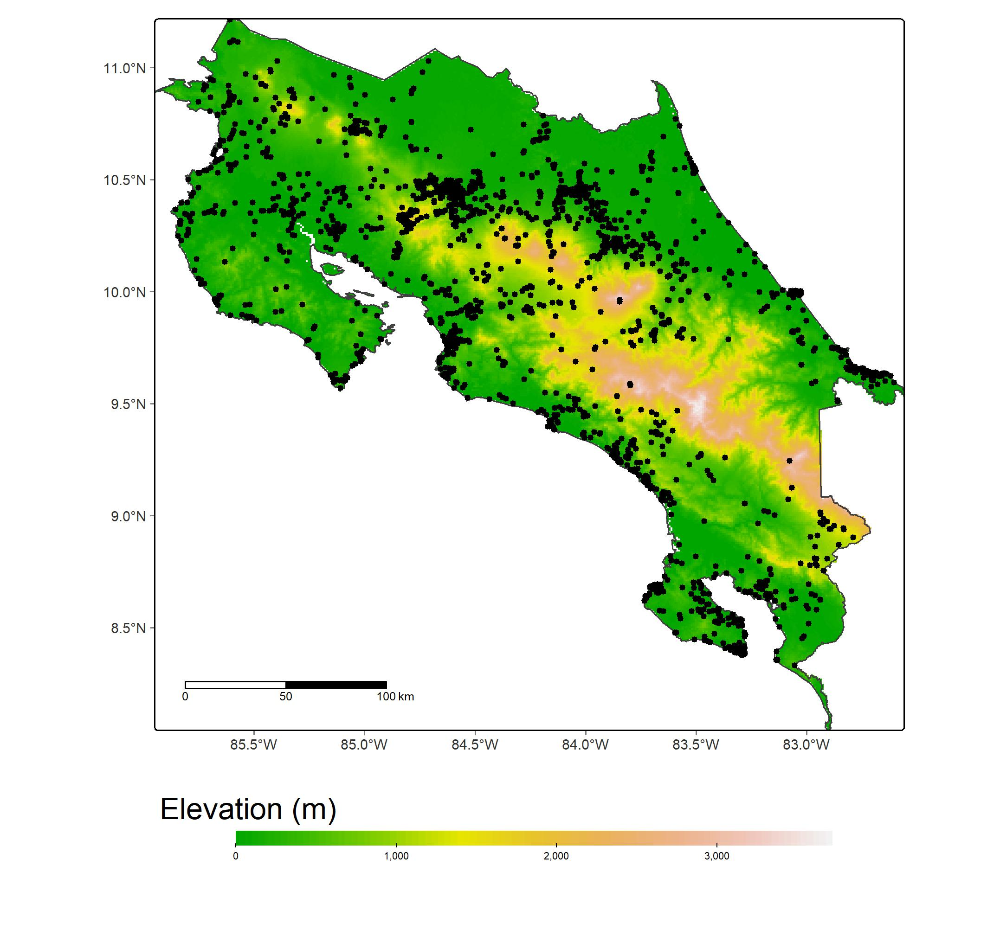
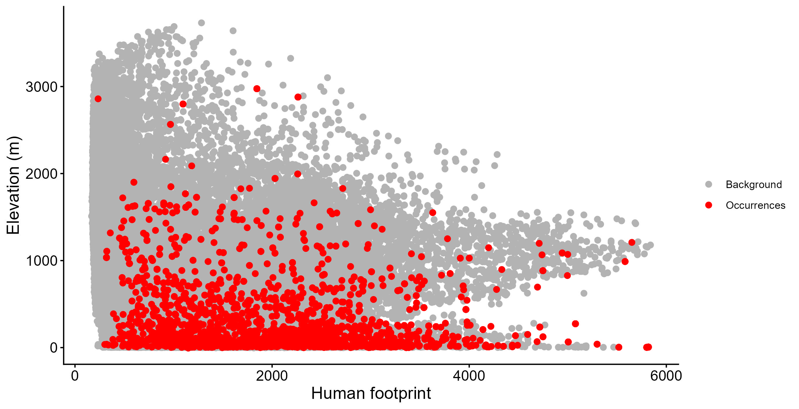
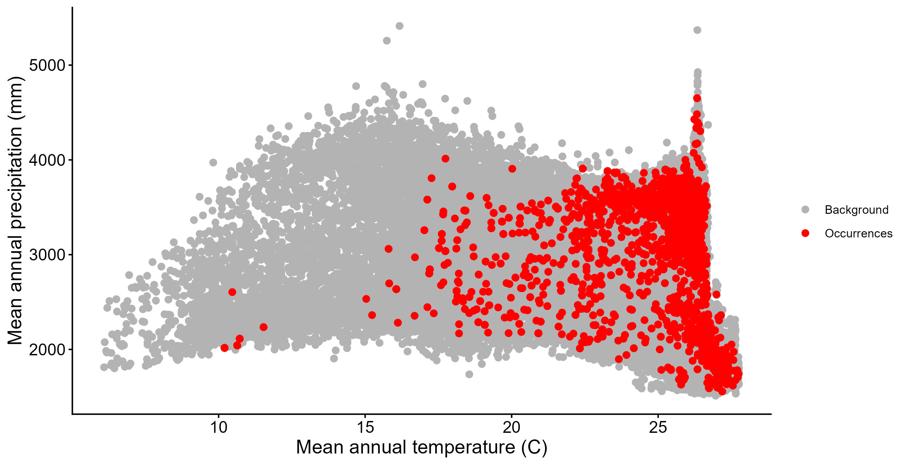
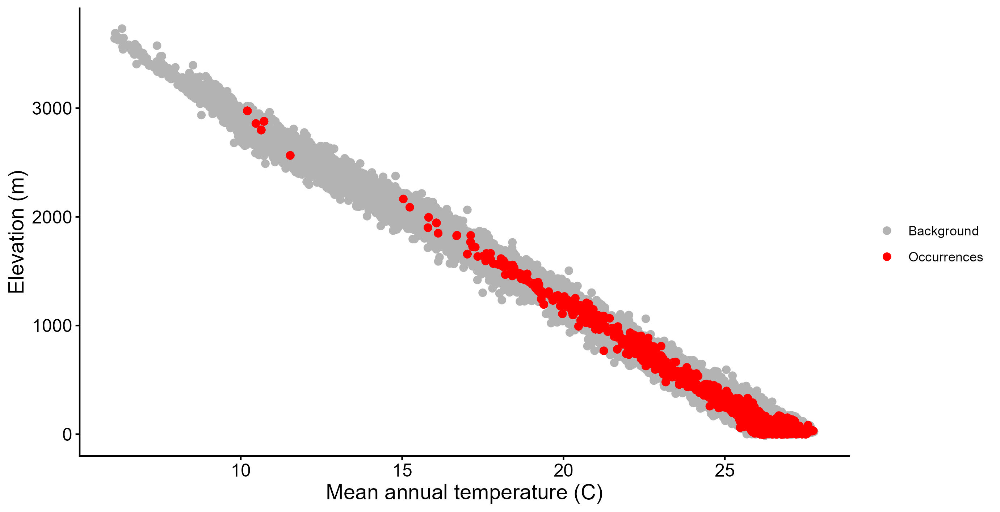

## Introduction

The spectacled owl (*Pulsatrix perspicillata*) is a widely distributed Neotropical species associated with a range of environments, including humid and dry tropical forests, wetlands, and savannas. In Costa Rica, it is primarily nocturnal and may use both forest interiors and edges to forage. Analyzing its records in relation to variables such as elevation, mean annual temperature, and human footprint helps describe some of the environmental conditions in which it has been observed. However, these associations alone do not demonstrate habitat preference or explain the causes of its distribution. [IUCN Red List](https://doi.org/10.2305/IUCN.UK.2018-2.RLTS.T22689180A130161018.en), [Área de Conservación Guanacaste](https://www.acguanacaste.ac.cr/bosque_seco_virtual/bs_web_page/paginas_de_especies/pulsatrix_perspicillata.html).

## Objetive

To describe the distribution of *Pulsatrix perspicillata* records in Costa Rica and their relationship to elevation, mean annual temperature, and human footprint by comparing them with the background environmental conditions shown in the figures..

## Metodology

Occurrence records of *Pulsatrix perspicillata* in Costa Rica were analyzed. Coordinates were represented in the WGS84 coordinate reference system. For the temporal analysis, records were classified into two periods: before 2000 and from 2000 onward.

Raster layers of mean annual temperature, annual precipitation, elevation, and human footprint were used. To make them comparable, they were adjusted to the same extent and spatial resolution: the elevation layer was cropped, and the human footprint layer was resampled using bilinear interpolation.

Environmental values were then extracted for each record and compared with values from the available raster cells, which were used as an environmental background. Maps of the records and scatterplots were produced to visualize relationships among environmental variables and compare records between periods. Figures were exported as JPG files at 300 dpi.

The procedure is descriptive and exploratory: the script does not perform statistical tests or model the species’ distribution.

## Kernel density methodology

Records of *Pulsatrix perspicillata* were cleaned by converting coordinates to numeric format, removing duplicate localities, and retaining those that intersect Costa Rica. The points were then projected to CRTM05 so distances could be calculated in meters.

A Gaussian kernel density surface was estimated using a bandwidth of 5,000 m and 500 m cells. The surface was cropped and masked to the boundaries of Costa Rica, and values were expressed as recorded localities per km².

Polygons representing 50% and 95% of the cumulative density were delineated. The 50% polygon represents areas with the highest concentration of records, while the 95% polygon covers a broader region. These results describe the concentration of recorded localities; they do not represent individual abundance or confirmed distribution boundaries.

## Results

{fig-align="center"}

{fig-align="center"}

{fig-align="center"}

{fig-align="center"}

## Interpretations

**Figure 1. Elevation and records in Costa Rica.** The map shows an elevation gradient: green areas correspond to lower elevations, while yellow, orange, and lighter tones indicate higher terrain. The black points appear across different parts of the country, with visible concentrations in the north and central regions. If these points represent records of the species, they suggest that it has been observed across a range of elevations. The map shows elevation and point locations; on its own, it does not identify areas of higher habitat suitability.

**Figure 2. Human footprint and elevation.** Occurrence records (red) are concentrated mainly at low and intermediate elevations, although some appear at higher elevations. Background points (gray) cover a broader range of conditions. Since these points represent reference areas and are not necessarily locations where the species is absent, the figure allows comparison with available conditions but is not sufficient to conclude that the species prefers specific levels of human footprint. The figure also does not specify the units of the human-footprint axis.

**Figure 3. Mean annual temperature and elevation.** A clear inverse relationship is visible: locations at higher elevations tend to have lower mean temperatures. Most records (red) cluster at low and intermediate elevations and relatively warm temperatures; a few occur in colder, higher-elevation conditions. Since temperature and elevation vary together in the figure, the pattern cannot be attributed to either variable alone.

## Conclusions

- Los registros representados abarcan condiciones ambientales diversas, pero se concentran sobre todo en elevaciones bajas e intermedias.

- La distribución de los puntos de ocurrencia sigue el gradiente conjunto de elevación y temperatura; las figuras no permiten separar el efecto de cada variable.

- La relación con la huella humana requiere análisis adicional, considerando la escala del índice y el esfuerzo de muestreo.

## Bibliography
