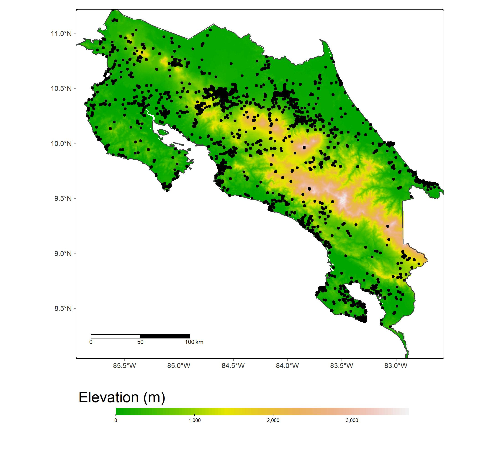
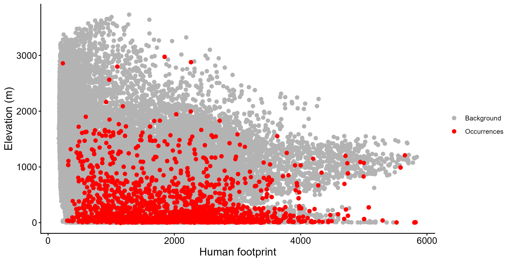
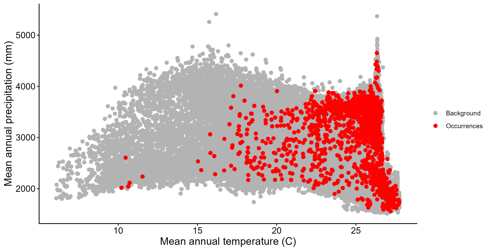
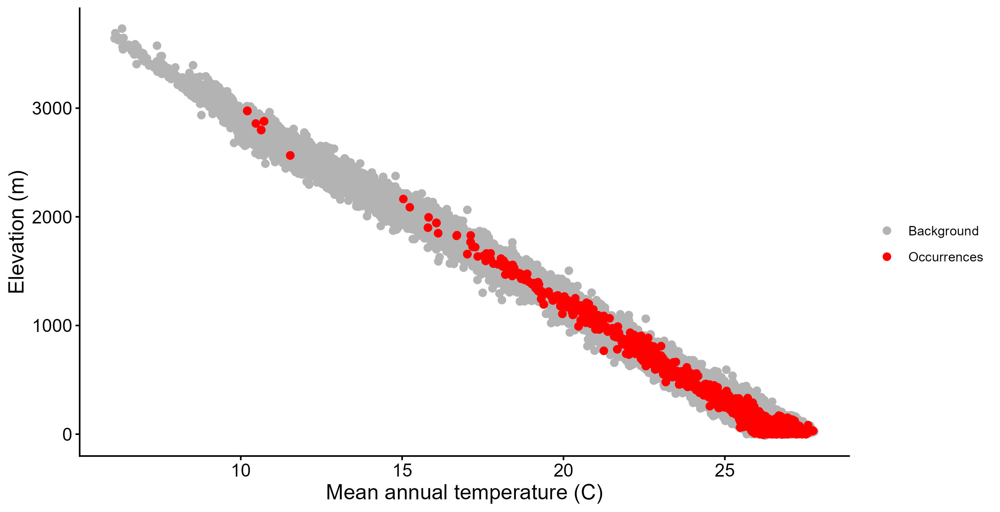

## Introduction

## Objetive

## Metodology

## Results

{fig-align="center"}

{fig-align="center"}

{fig-align="center"}

{fig-align="center"}

## Interpretations

## Conclusions

## Bibliography
