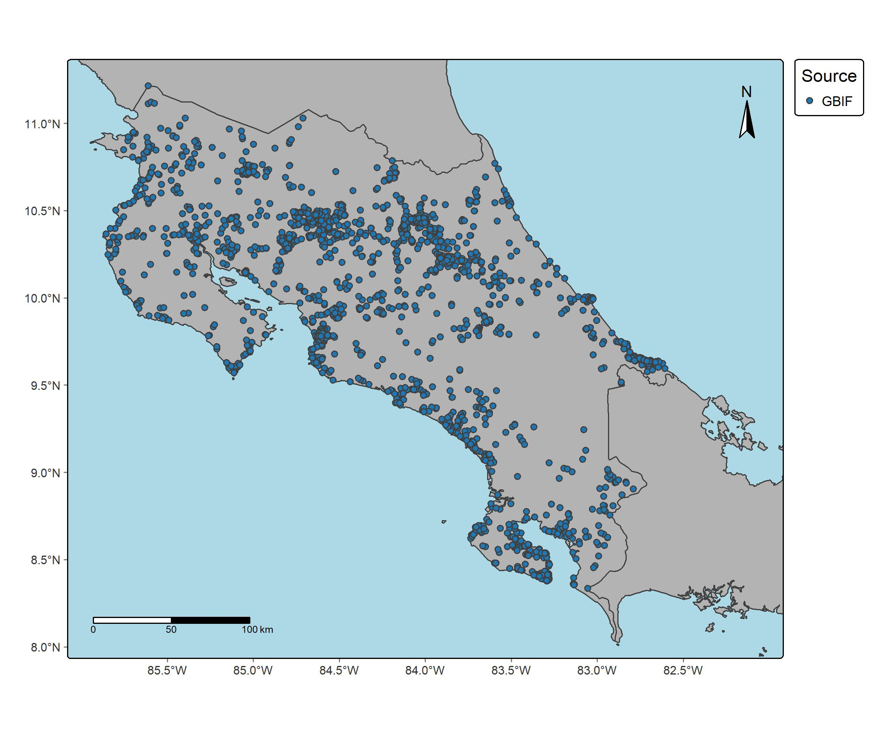
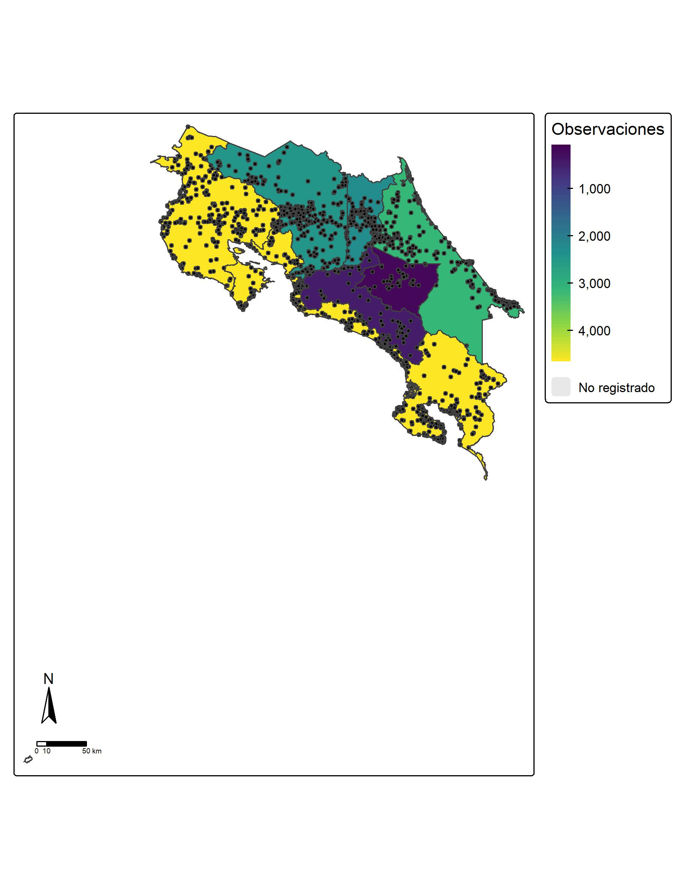
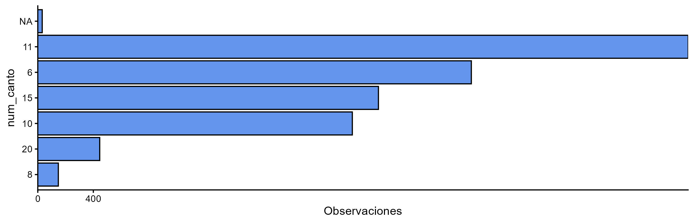

## Introduction

Occurrence records show where a species has been observed. They can be used to examine how observations are distributed across different locations and to identify patterns that may help assess whether the species is at risk or whether certain factors influence its distribution.

This study examines the geographic distribution of *Pulsatrix perspicillata*, commonly known in Costa Rica as the spectacled owl, or “oropopo.” To gather as many records as possible, the study uses reliable sources that document biodiversity observations, including iNaturalist and the Global Biodiversity Information Facility (GBIF).

However, occurrence records may contain errors or missing information, which can affect the reliability of a study. It is therefore important to clean the downloaded data and retain accurate, relevant records to support sound interpretation of the results.

## Objetive

To download occurrence records for *Pulsatrix perspicillata* from iNaturalist and GBIF, clean the data by identifying records with missing or questionable information, and use the curated dataset to analyze the species’ geographic distribution across the provinces and cantons of Costa Rica.

## Metodology

First, RStudio was connected to the GBIF and iNaturalist platforms. Occurrence records were then downloaded from both sources and imported into RStudio to check their content and structure. The records were cleaned and transformed using packages such as **tidyverse**. Costa Rica’s provincial and cantonal boundary layers were also prepared and converted to the WGS 84 coordinate reference system (EPSG:4326) to ensure consistency with the occurrence coordinates. This process produced a cleaned and organized dataset of *Pulsatrix perspicillata* records for spatial analysis.

The occurrence coordinates were converted into spatial objects and overlaid with boundary layers, including the canton layer, so that administrative information could be assigned to each observation. Finally, records were counted by province and canton.

## Results

## Interpretations

## Conclusions

## Bibliography
